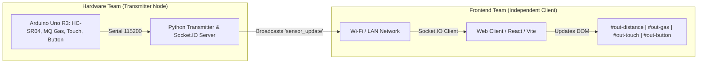

# Arduino Sensor Telemetry & Socket.IO Receiver

Implementation of the **Frontend Workflow & Receiver Integration Guide** for decoupled hardware and presentation layers.

---

## 🌟 Architecture & Operational Workflow



* **Completely Decoupled**: The frontend requires no local Python, Arduino, or backend server. It connects directly via Socket.IO to the transmitter's local IP address or runs offline via the built-in mock generator.
* **Standard Broadcast Event**: `'sensor_update'`
* **Data Payload**:
  ```json
  {
    "distance": 45,
    "gas": 320,
    "touch": "CLEAR",
    "button": "RELEASED"
  }
  ```

---

## 🚀 Quickstart for Both Teams

### 1. Hardware Team (Start the Pipeline)
Run the master script to start the Arduino simulator and the Socket.IO broadcast transmitter:
```powershell
python run_all.py
```
* **Step 1 (IP Handshake)**: Note the local IP address printed in the console (e.g. `http://192.168.1.100:5000` or `http://10.207.13.177:5000`) and provide it to the frontend team.
* **Built-in Web Dashboard**: You can also open `http://localhost:5000` directly in your browser.

---

### 2. Frontend Team (Connect to Transmitter)

#### Option A: Vanilla JavaScript Integration
```javascript
// Step 2: Set the Transmitter IP provided by the hardware team
const TRANSMITTER_IP = 'http://192.168.1.100:5000'; // or http://127.0.0.1:5000
const socket = io(TRANSMITTER_IP);

// Step 3: Listen for broadcast events
socket.on('sensor_update', (data) => {
  document.getElementById('out-distance').innerText = data.distance + ' cm';
  document.getElementById('out-gas').innerText = data.gas;
  document.getElementById('out-touch').innerText = data.touch;
  document.getElementById('out-button').innerText = data.button;
});
```

#### Option B: React.js Component Integration
Import the drop-in component [`TelemetryDashboard.jsx`](file:///c:/Prithvi/LAB605/TelemetryDashboard.jsx):
```jsx
import TelemetryDashboard from './TelemetryDashboard';

function App() {
  return <TelemetryDashboard />;
}
```

---

## 🧪 Working Offline (No Hardware Available)

If the hardware team is offline, use the built-in mock generator (from Section 3 of the guide).

Click the **"🧪 Switch to Offline Mock"** button on the web dashboard, or run:
```javascript
function startMockingData() {
  console.log("Starting offline mock data generator...");
  setInterval(() => {
    const mockData = {
      distance: Math.floor(Math.random() * 100) + 10, // 10 to 110 cm
      gas: Math.floor(Math.random() * 500) + 200,      // 200 to 700 ppm
      touch: Math.random() > 0.5 ? "TOUCHED" : "CLEAR",
      button: Math.random() > 0.8 ? "PRESSED" : "RELEASED"
    };
    updateUI(mockData);
  }, 500);
}
```

---

## 📁 Repository Files

* **[`arduino_uno_simulator.py`](file:///c:/Prithvi/WebSocket Live Tele/arduino_uno_simulator.py)**: Simulates the Arduino Uno reading ultrasonic distance, MQ gas, touch sensor, and pushbutton.
* **[`transmitter.py`](file:///c:/Prithvi/WebSocket Live Tele/transmitter.py)**: Python hardware transmitter & Socket.IO server broadcasting `'sensor_update'` with local IP detection.
* **[`TelemetryDashboard.jsx`](file:///c:/Prithvi/WebSocket Live Tele/TelemetryDashboard.jsx)**: Ready-to-use React.js component (Section 4 of the guide).
* **[`Arduino_Sensors.ino`](file:///c:/Prithvi/WebSocket Live Tele/Arduino_Sensors.ino)**: Arduino C++ sketch to flash to a physical Arduino Uno.
* **[`static/index.html`](file:///c:/Prithvi/WebSocket Live Tele/static/index.html)**: Live web feed dashboard with exact DOM IDs (`out-distance`, `out-gas`, `out-touch`, `out-button`).
* **[`static/app.js`](file:///c:/Prithvi/WebSocket Live Tele/static/app.js)**: Socket.IO receiver script with offline mock mode.
* **[`static/style.css`](file:///c:/Prithvi/WebSocket Live Tele/static/style.css)**: Glassmorphism dark UI with radar sweep, tactile touch pad, and 3D button.
* **[`run_all.py`](file:///c:/Prithvi/WebSocket Live Tele/run_all.py)**: 1-click launcher for the entire stack.
